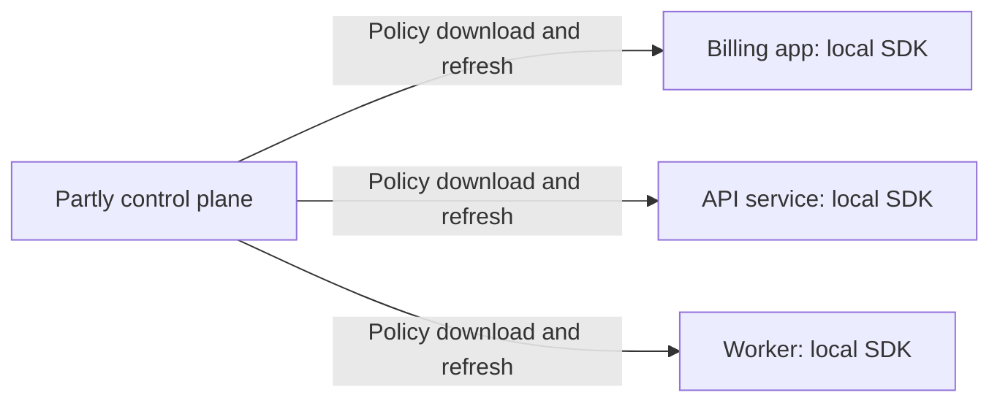
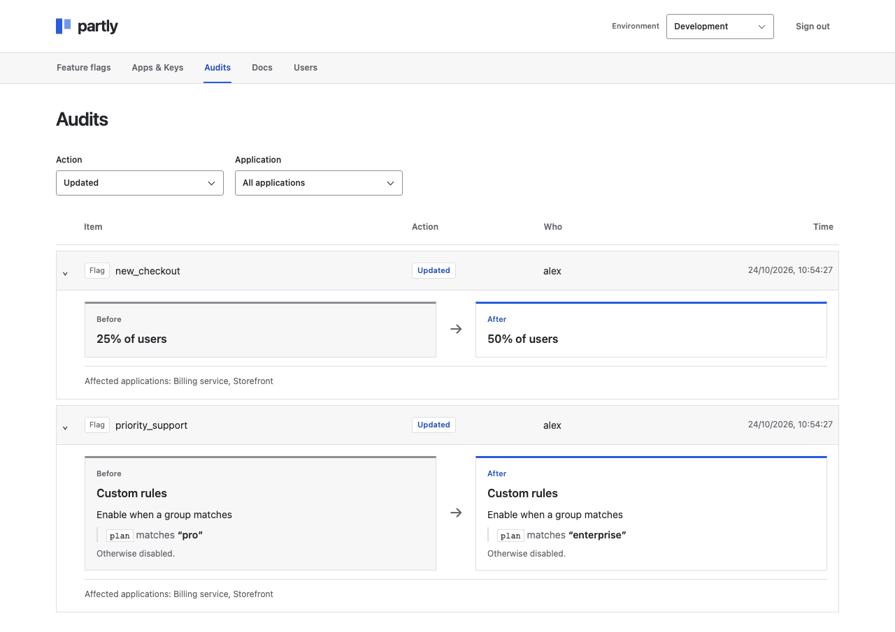

<h1> Partly</h1>

Partly is a self-hosted feature flag tool: one Rust executable with a dashboard and SQLite. No Docker or external services required.

Turn features on or off, roll them out by percentage, or match custom rules. The Python, Rust, Go, and Node.js SDKs evaluate flags locally; user context stays in your application.

Manage app-scoped API Keys and environment permissions, review audit changes, and see each flag's last reported use in the dashboard.

**Alpha:** `0.1.0-alpha.1` (Python: `0.1.0a1`). Public downloads are not available yet.


## Build locally

Building from source requires Rust 1.89+ and a C compiler. Running the compiled executable needs neither. From the repository root:

```sh
cargo build --release --locked -p partly-server
./target/release/partly serve --host 127.0.0.1 --port 8080 --db ./partly.db
```

1. Open <http://127.0.0.1:8080> and create an admin account (password: at least 12 characters).
2. In **Development**, create `new_checkout` with **Enabled for everyone**.
3. Under **Apps & Keys**, create an app, select its flags, and copy its application ID and API Key.
4. Open **Docs**, choose your language, and copy the complete SDK example.

Setup creates the database. Reuse its path on restart. For remote access, [configure HTTPS](crates/partly-server/README.md#https).

## Connect an application

| Language | Setup and API | Runnable example |
| --- | --- | --- |
| Python (CPython 3.14) | [SDK guide](sdk/python/README.md) | [Quickstart](examples/python/README.md) |
| Rust | [SDK guide](sdk/rust/README.md) | [Quickstart](examples/rust/README.md) |
| Go | [SDK guide](sdk/go/README.md) | [Quickstart](examples/go/README.md) |
| Node.js / TypeScript | [SDK guide](sdk/node/README.md) | [Quickstart](examples/node/README.md) |

Set the server URL, environment, application ID, and API Key. Initialize once at application startup, reuse the client for local evaluations, and close it at shutdown. The dashboard shows these same tested examples, including error handling.

The quickstarts and dashboard use [OpenFeature](docs/openfeature.md) as the application API. Register a provider after Partly initializes, then reuse the official OpenFeature client for local Boolean checks. Examples handle errors explicitly. Native APIs remain available. See [tested versions and limits](docs/openfeature.md#coverage-and-limits), including Rust's upstream differences.

## How it compares

Self-hosted capabilities, reviewed October 2026. Linked sources describe each tool; availability can vary by edition and SDK. **Self-hosted** means your organization runs the control service. **Local evaluation** means flag checks run inside each application; the control service can be on another machine.

| Capability | **Partly** | [Flipt](https://docs.flipt.io/v2/concepts) | [GO Feature Flag](https://gofeatureflag.org/docs/configure_flag/create-flags) | [Unleash](https://docs.getunleash.io/concepts/activation-strategies) | [Flagsmith](https://docs.flagsmith.com/managing-flags/core-management) |
| --- | --- | --- | --- | --- | --- |
| Server language | Rust | Go | Go | TypeScript / Node.js | Python / Django |
| Storage | SQLite | Git | Configuration files | PostgreSQL | PostgreSQL |
| Standalone server binary | ✅ | ✅ | ✅ | ❌ | ❌ |
| Self-hosted central service | ✅ | ✅ | ✅ (relay) | ✅ | ✅ |
| One service for multiple apps | ✅ | ✅ | ✅ | ✅ | ✅ |
| Flag grouping | App selections from shared environment flags | [Namespaces](https://docs.flipt.io/v2/concepts#namespaces) | [Independent flag sets](https://gofeatureflag.org/docs/concepts/flagset) | [Projects: one in OSS; multiple in Enterprise](https://docs.getunleash.io/concepts/projects) | [Projects](https://docs.flagsmith.com/flagsmith-concepts/data-model) |
| Boolean flags | ✅ | ✅ | ✅ | ✅ | ✅ |
| Percentage rollouts | ✅ | ✅ | ✅ | ✅ | ✅ |
| Context-based targeting | ✅ | ✅ | ✅ | ✅ | ✅ |
| Flag change history | ✅ Audit log | ✅ [Git history](https://docs.flipt.io/v2/introduction#git-native) | Configuration store history / [notifiers](https://gofeatureflag.org/docs/concepts/notifier) | ✅ [Basic; advanced in Enterprise](https://docs.getunleash.io/support/oss-comparison#governance-and-security) | ✅ [Audit logs](https://www.flagsmith.com/role-based-access-change-control-security) |
| Non-boolean flag values | ❌ | ✅ | ✅ | ✅ | ✅ |
| Local backend evaluation | ✅ | ✅ | ✅ (by provider) | ✅ | ✅ (opt-in) |

GO Feature Flag can send change notifications to logs or other systems; retaining that history depends on the configured destination or configuration store.

Deployment details: [Flipt](https://docs.flipt.io/v2/introduction), [GO Feature Flag](https://gofeatureflag.org/docs/concepts/architecture), [Unleash](https://docs.getunleash.io/deploy/configuring-unleash), [Flagsmith](https://docs.flagsmith.com/deployment-self-hosting/hosting-guides/manual-installation).

[Unleash](https://docs.getunleash.io/deploy/getting-started) and [Flagsmith](https://docs.flagsmith.com/flagsmith-concepts/platform-architecture) also offer vendor-hosted control planes. GO Feature Flag's relay serves multiple applications; its Go library can also run directly from configuration without a relay. A shared control plane with local SDK evaluation is a supported pattern across these tools.

### One server, multiple applications

Run Partly once on a shared server with [HTTPS](crates/partly-server/README.md#https). Create an app under **Apps & Keys**, select its flags, and give its SDK the server URL, environment, application ID, and API Key. Each application downloads policy and evaluates flags locally.



One instance has Development and Production environments, individual accounts, and environment permissions. Apps select shared flags within their environment; each key can download only its app's selection. Multiple keys support rotation, and revoked keys remain identifiable in history.

Before changing a flag, review the affected apps and type `environment/flag_name` to confirm. The Audits tab records each account’s changes as readable state transitions. Administrators manage accounts in **Users**; [environment roles](crates/partly-server/README.md#users-and-permissions) separate readers, flag editors, and app/key managers. Organization-wide capacity testing remains future work.

Flags and API Keys show **Last reported use**. SDKs batch checked flag names in the background; contexts and decisions stay local. Reports help find cleanup candidates, but missing activity does not prove a flag is unused. See [usage reporting](crates/partly-server/README.md#usage-reporting).

<details>
<summary>Preview the audit log</summary>



</details>

### SDKs

SDK availability is separate from the server's implementation language:

| SDK | **Partly** | [Flipt](https://github.com/flipt-io/flipt-client-sdks#language-support) | [GO Feature Flag](https://gofeatureflag.org/docs/sdk) | [Unleash](https://docs.getunleash.io/sdks) | [Flagsmith](https://docs.flagsmith.com/integrating-with-flagsmith/sdks/server-side) |
| --- | --- | --- | --- | --- | --- |
| Python | ✅ | ✅ | ✅ | ✅ | ✅ |
| Rust | ✅ | ✅ Remote | ✅ [OFREP, remote](https://gofeatureflag.org/docs/sdk/server_providers/openfeature_rust) | ✅ | ✅ |
| Go | ✅ | ✅ | ✅ | ✅ | ✅ |
| Node.js / TypeScript | ✅ | ✅ | ✅ | ✅ | ✅ |
| Java | ❌ | ✅ | ✅ | ✅ | ✅ |
| .NET | ❌ | ✅ | ✅ | ✅ | ✅ |
| Ruby | ❌ | ✅ | ✅ | ✅ | ✅ |
| PHP | ❌ | ✅ Remote | ✅ | ✅ | ✅ |
| Browser JavaScript | ❌ | ✅ | ✅ | ✅ | ✅ |
| iOS / Swift | ❌ | ✅ | ✅ | ✅ | ✅ |
| Android / Kotlin | ❌ | ✅ | ✅ | ✅ | ✅ |

GO Feature Flag uses OpenFeature providers or its Go library; Rust uses OpenFeature's remote evaluation protocol (OFREP). Flipt's [Rust and PHP SDKs](https://github.com/flipt-io/flipt-server-sdks#language-support) also evaluate remotely. Flagsmith lists its [browser and mobile SDKs](https://docs.flagsmith.com/integrating-with-flagsmith/sdks#client-side-sdks). Check each SDK's evaluation mode before choosing it.

### Memory

| Memory | **Partly** | [Flipt](https://github.com/flipt-io/helm-charts/blob/main/charts/flipt-v2/values.yaml) | [GO Feature Flag](https://github.com/thomaspoignant/go-feature-flag/blob/main/cmd/relayproxy/helm-charts/relay-proxy/values.yaml) | [Unleash](https://docs.getunleash.io/deploy/configuring-unleash#resource-recommendations) | [Flagsmith](https://docs.flagsmith.com/deployment-self-hosting/scaling-and-performance/sizing-and-scaling#small) |
| --- | --- | --- | --- | --- | --- |
| Server RAM | ~26.2 MiB measured | Not specified | 128 MiB requested by Helm chart | 512 MiB–1 GiB recommended | 2 × 2 GB API workers recommended |
| Other RAM in the cited setup | SQLite included | None required | None required | ≥1 GiB for PostgreSQL recommended | 8 GB database + 2 GB task worker recommended |

Flipt leaves resource settings unset; its commented 128 MiB example is not a recommendation. GO Feature Flag's figure is a Kubernetes reservation, not measured use. Unleash gives a starting recommendation; Flagsmith describes its Small production tier, including a load balancer. Flagsmith can [bundle the dashboard and API](https://github.com/Flagsmith/flagsmith/blob/main/Dockerfile), and its separate [task worker is optional](https://docs.flagsmith.com/deployment-self-hosting/scaling-and-performance/asynchronous-task-processor).

Partly's figure is sampled server memory after setup in the [local benchmark](tests/benchmark.py), run on October 24, 2026 with one flag and no application load. It excludes the application SDK and browser. A production RAM recommendation still needs load testing. These figures use different workloads and deployment sizes, so they do not establish a memory ranking.

The same run measured about **0.57 µs per native Python SDK evaluation**, including the Rust binding and usage tracking: the median of five batches of 100,000 calls with one 50% flag and a fixed user ID. This excludes OpenFeature and report dispatch. It measures batch averages, not tail latency or a cross-product speed comparison.

## Roadmap

Keep the current release controls, OpenFeature integrations, permissions, audits, and lightweight usage reporting. Next:

1. Finish [public downloads and SDK distribution](docs/publishing.md).
2. Verify real first-use deployments and fix observed friction.

Git integration, approval workflows, lifecycle automation, HA, SSO, richer flag values, and more SDKs are outside the committed scope. New features need evidence from adopters.

## Alpha limits

- One server; no SSO or high availability. API Keys are stored as plaintext in SQLite and backups; keep these files private.
- Policies stay in SDK memory. Running clients keep working during outages; new processes need the server to initialize. Revocation takes effect when the client receives it.
- Release targets: macOS ARM64 and Linux x86_64. See [verified coverage](docs/releasing.md).

## Guides

- [Server: logs, HTTPS, backups, and password recovery](crates/partly-server/README.md)
- [OpenFeature: integration, verified behavior, and limits](docs/openfeature.md)
- [Evaluation rules and percentage consistency](crates/partly-core/README.md)
- [Development checks and release preparation](docs/releasing.md)

## Project layout

```text
crates/     Shared Rust evaluator, native bindings, and control plane
sdk/        Python, Rust, Go, and Node.js SDKs
examples/   Runnable application examples
tests/      Integration, browser, and cross-language tests
config/     Frontend checks and development dependencies
scripts/    Packaging and release checks
docs/       Guides and README images
licenses/   Dependency notices and their generation settings
```

Workspace manifests stay at the root. Python lint, type, and test settings share `pyproject.toml`.

## License

The control plane and dashboard are source-available under **Elastic License 2.0**. The SDKs, shared evaluator, native bindings, and application examples use **Apache-2.0**. See [licensing details](docs/licensing.md).
