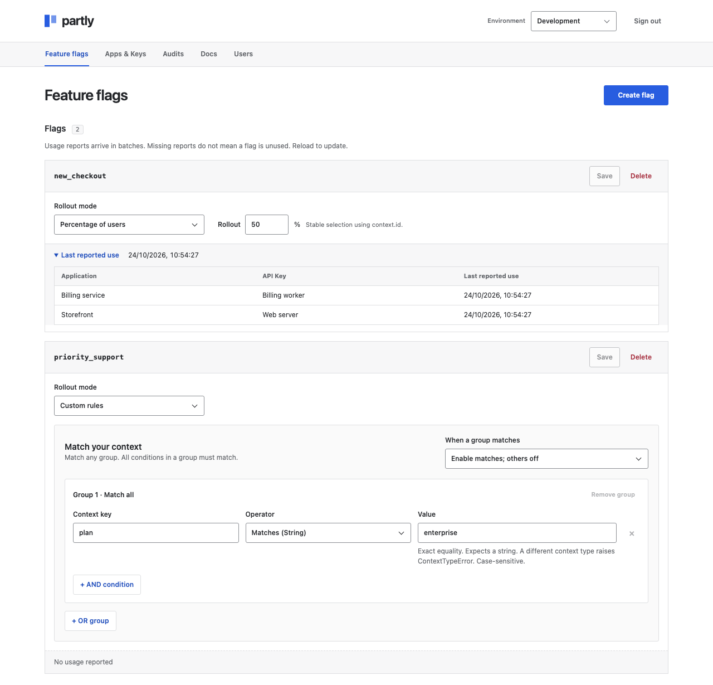
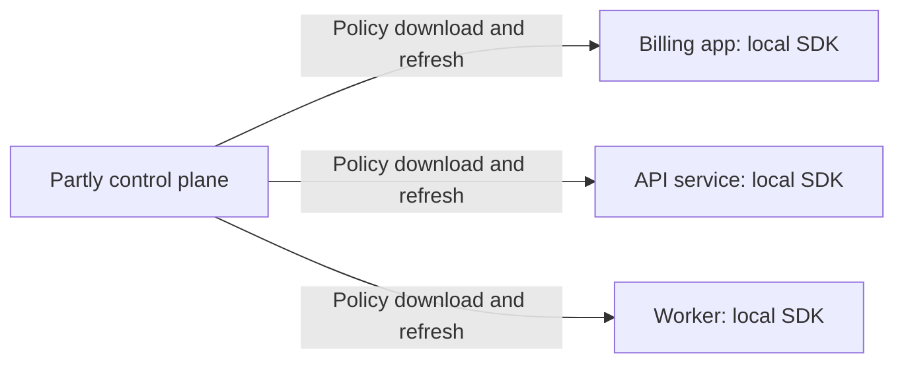

<h1> Partly</h1>

Partly is a self-hosted feature flag tool: one Rust executable with a dashboard and SQLite. No Docker or external services required.

Turn features on or off, roll them out by percentage, or match custom rules. The Python, Rust, Go, and Node.js SDKs evaluate flags locally; user context stays in your application.

**Alpha:** `0.1.0-alpha.1` (Python: `0.1.0a1`). Public downloads are not available yet.



## Run locally

Requires Rust 1.89+ and a C compiler. From the repository root:

```sh
cargo build --release --locked -p partly-server
./target/release/partly serve --host 127.0.0.1 --port 8080 --db ./partly.db
```

1. Open <http://127.0.0.1:8080> and create an admin account (password: at least 12 characters).
2. In **Development**, create `new_checkout` with **Enabled for everyone**.
3. Under **Key Management**, generate and copy an API Key.

Setup creates the database. Reuse its path on restart. For remote access, [configure HTTPS](crates/partly-server/README.md#https).

## Try Python

Use regular CPython 3.14. In another terminal, from the repository root:

```sh
python3.14 -m venv .venv
source .venv/bin/activate
python -m pip install 'maturin>=1.9.4,<2'
maturin build --release --locked --manifest-path sdk/python/Cargo.toml --out target/wheels -i python3.14
python -m pip install target/wheels/partly_sdk-0.1.0a1-cp314-cp314-*.whl
```

Replace `YOUR_API_KEY` in [quickstart.py](examples/python/quickstart.py), then run:

```sh
python examples/python/quickstart.py
```

## How it compares

Self-hosted capabilities, reviewed October 2026. Linked sources describe each tool; availability can vary by edition and SDK. **Self-hosted** means your organization runs the control service. **Local evaluation** means flag checks run inside each application; the control service can be on another machine.

| Capability | **Partly** | [Flipt](https://docs.flipt.io/v2/concepts) | [GO Feature Flag](https://gofeatureflag.org/docs/configure_flag/create-flags) | [Unleash](https://docs.getunleash.io/concepts/activation-strategies) | [Flagsmith](https://docs.flagsmith.com/managing-flags/core-management) |
| --- | --- | --- | --- | --- | --- |
| Server language | Rust | Go | Go | TypeScript / Node.js | Python / Django |
| Storage | SQLite | Git | Configuration files | PostgreSQL | PostgreSQL |
| Standalone server binary | ✅ | ✅ | ✅ | ❌ | ❌ |
| Self-hosted central service | ✅ | ✅ | ✅ (relay) | ✅ | ✅ |
| One service for multiple apps | ✅ | ✅ | ✅ | ✅ | ✅ |
| Separate app/project flag collections | ❌ | ✅ [Namespaces](https://docs.flipt.io/v2/concepts#namespaces) | ✅ [Flag sets](https://gofeatureflag.org/docs/concepts/flagset) | ✅ [Projects (Enterprise)](https://docs.getunleash.io/concepts/projects) | ✅ [Projects](https://docs.flagsmith.com/flagsmith-concepts/data-model) |
| Boolean flags | ✅ | ✅ | ✅ | ✅ | ✅ |
| Percentage rollouts | ✅ | ✅ | ✅ | ✅ | ✅ |
| Context-based targeting | ✅ | ✅ | ✅ | ✅ | ✅ |
| Non-boolean flag values | ❌ | ✅ | ✅ | ✅ | ✅ |
| Local backend evaluation | ✅ | ✅ | ✅ (by provider) | ✅ | ✅ (opt-in) |

Deployment details: [Flipt](https://docs.flipt.io/v2/introduction), [GO Feature Flag](https://gofeatureflag.org/docs/concepts/architecture), [Unleash](https://docs.getunleash.io/deploy/configuring-unleash), [Flagsmith](https://docs.flagsmith.com/deployment-self-hosting/hosting-guides/manual-installation).

[Unleash](https://docs.getunleash.io/deploy/getting-started) and [Flagsmith](https://docs.flagsmith.com/flagsmith-concepts/platform-architecture) also offer vendor-hosted control planes. GO Feature Flag's relay serves multiple applications; its Go library can also run directly from configuration without a relay. A shared control plane with local SDK evaluation is a supported pattern across these tools.

### One server, multiple applications

Run Partly once on a shared server with [HTTPS](crates/partly-server/README.md#https). Give each application's SDK the same server URL and a separately named API Key for its environment. Each application downloads policy and evaluates flags locally.



Today, one instance has one shared project, Development and Production environments, and one admin. All keys in an environment can download its complete policy; a key's name does not restrict it to an application. Separate keys allow independent revocation, but app-level policy isolation and team permissions are not implemented. Organization-wide capacity still needs load testing.

### SDKs

SDK availability is separate from the server's implementation language:

| SDK | **Partly** | [Flipt](https://github.com/flipt-io/flipt-client-sdks#language-support) | [GO Feature Flag](https://gofeatureflag.org/docs/sdk) | [Unleash](https://docs.getunleash.io/sdks) | [Flagsmith](https://docs.flagsmith.com/integrating-with-flagsmith/sdks/server-side) |
| --- | --- | --- | --- | --- | --- |
| Python | ✅ | ✅ | ✅ | ✅ | ✅ |
| Rust | ✅ | ✅ | ✅ | ✅ | ✅ |
| Go | ✅ | ✅ | ✅ | ✅ | ✅ |
| Node.js / TypeScript | ✅ | ✅ | ✅ | ✅ | ✅ |
| Java | ❌ | ✅ | ✅ | ✅ | ✅ |
| .NET | ❌ | ✅ | ✅ | ✅ | ✅ |
| Ruby | ❌ | ✅ | ✅ | ✅ | ✅ |
| PHP | ❌ | ✅ | ✅ | ✅ | ✅ |
| Browser JavaScript | ❌ | ✅ | ✅ | ✅ | ✅ |
| iOS / Swift | ❌ | ✅ | ✅ | ✅ | ✅ |
| Android / Kotlin | ❌ | ✅ | ✅ | ✅ | ✅ |

GO Feature Flag uses OpenFeature providers or its Go library. Flipt's [Rust and PHP SDKs](https://github.com/flipt-io/flipt-server-sdks#language-support) evaluate remotely. Flagsmith also lists its [browser and mobile SDKs](https://docs.flagsmith.com/integrating-with-flagsmith/sdks#client-side-sdks). SDK availability does not imply local evaluation in every language or runtime.

### Memory

| Memory | **Partly** | [Flipt](https://github.com/flipt-io/helm-charts/blob/main/charts/flipt-v2/values.yaml) | [GO Feature Flag](https://github.com/thomaspoignant/go-feature-flag/blob/main/cmd/relayproxy/helm-charts/relay-proxy/values.yaml) | [Unleash](https://docs.getunleash.io/deploy/configuring-unleash#resource-recommendations) | [Flagsmith](https://docs.flagsmith.com/deployment-self-hosting/scaling-and-performance/sizing-and-scaling#small) |
| --- | --- | --- | --- | --- | --- |
| Server RAM | ~25.5 MiB measured | Not specified | 128 MiB requested by Helm chart | 512 MiB–1 GiB recommended | 2 × 2 GB API workers recommended |
| Additional services | SQLite included | None required | None required | ≥1 GiB for PostgreSQL | 8 GB database + 2 GB task worker; frontend and load balancer also needed |

Flipt leaves resource settings unset; its commented 128 MiB example is not a recommendation. GO Feature Flag's figure is a Kubernetes reservation, not a usage limit. Unleash gives a starting recommendation; Flagsmith's figures describe its Small production tier.

Partly's figure is sampled server memory in a one-flag local test, excluding the application SDK and browser. A production RAM recommendation still needs load testing. These figures use different workloads and deployment sizes, so they do not establish a memory ranking.

The same [local benchmark](tests/benchmark.py) measured about **0.32 µs per Python evaluation**, including the Rust binding: five batches of 100,000 calls with one percentage flag and a fixed user. This is a batch average, not tail latency or a cross-product speed comparison.

## Roadmap

Proposed order, keeping the single executable and local evaluation:

1. **Release the existing SDKs.** Finish npm and Go distribution, verify installs from published artifacts, and make the server and four SDKs available through their normal channels. See [publishing work](docs/publishing.md).
2. **Set a tested memory budget.** Measure peak RAM under concurrent logins, policy refreshes, and larger flag sets on Linux. Publish a practical recommendation and track regressions.
3. **Support independent teams in one installation.** Add projects for applications or related services, with API Keys scoped to project and environment. Follow with individual admin accounts, project permissions, and a history of flag changes. This closes the gap between sharing a server and operating an organization-wide platform.
4. **Support OpenFeature.** Wrap the existing SDKs with providers for the standard feature-flag API, making adoption easier without replacing the Rust evaluator. Keep errors available through the detailed evaluation API.
5. **Add Java, then .NET.** Close the next backend SDK gaps using the shared evaluator and the same cross-language contract tests.
6. **Expand flag values when users need them.** Add string, number, and JSON values before weighted variants, while preserving the existing boolean API. This follows the feature gap in the comparison without adding an experimentation platform.

Browser/mobile SDKs, Ruby/PHP, reusable segments, and scheduled rollouts will be prioritized from user demand. SSO, HA, and experimentation analytics remain outside the near-term scope. The first release stays boolean-only with one shared project.

## Alpha limits

- One server and one admin. API Keys are stored as plaintext in SQLite and backups; keep these files private.
- Policies stay in SDK memory. Running clients keep working during outages; new processes need the server to initialize.
- Release targets: macOS ARM64 and Linux x86_64. See [verified coverage](RELEASING.md).

## Guides

- [Server: HTTPS, backups, and password recovery](crates/partly-server/README.md)
- SDK guides: [Python](sdk/python/README.md), [Rust](sdk/rust/README.md), [Go](sdk/go/README.md), [Node.js](sdk/node/README.md)
- [Evaluation rules and percentage consistency](crates/partly-core/README.md)
- [Development checks and release preparation](RELEASING.md)

## License

The control plane and dashboard are source-available under **Elastic License 2.0**. The SDKs, shared evaluator, native bindings, and application examples use **Apache-2.0**. See [licensing details](LICENSING.md).
