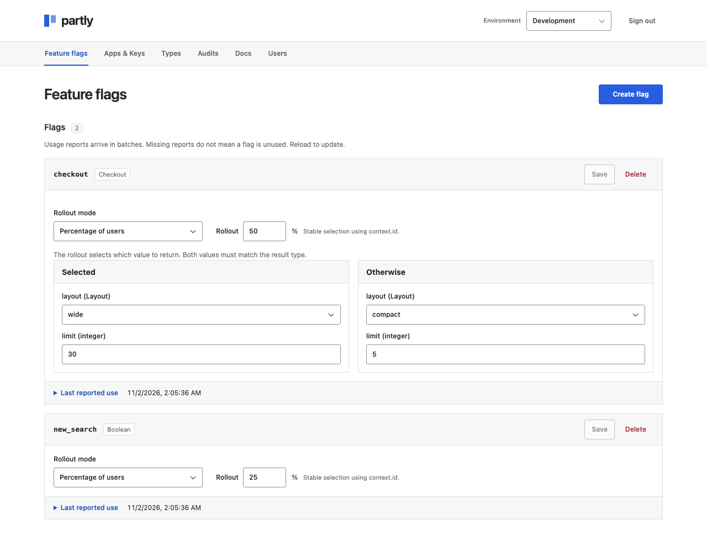

<h1> Partly</h1>

Self-hosted feature flags in one Rust executable, with a dashboard and SQLite. No Docker or external services required.

- Boolean flags with percentage rollouts and custom rules.
- Python, Rust, Go, and Node.js SDKs with OpenFeature providers.
- Shared flags, app-scoped API Keys, and environment permissions.
- Audit logs and last-reported usage. User context stays local.



## Build locally

Requires Rust 1.89+, a C compiler, and [Task](https://taskfile.dev/docs/installation). The compiled server needs none of these tools.

```sh
task build:server
./target/release/partly serve --host 127.0.0.1 --port 8080 --db ./partly.db
```

1. Open <http://127.0.0.1:8080> and create an administrator account.
2. Create `new_checkout` with **Enabled for everyone**. Under **Apps & Keys**, create an app and select that flag.
3. Copy the application ID and API Key, then follow your language's **Docs** example.

Reuse the database path on restart. Set up [HTTPS](crates/partly-server/README.md#https) before remote access.

**Alpha:** [GitHub downloads](https://github.com/ByteBaker/partly/releases) and [registry packages](docs/publishing.md) are not published yet.

## Connect an application

| SDK | Runnable example |
| --- | --- |
| [Python · CPython 3.14](sdk/python/README.md) | [Quickstart](examples/python/README.md) |
| [Rust](sdk/rust/README.md) | [Quickstart](examples/rust/README.md) |
| [Go](sdk/go/README.md) | [Quickstart](examples/go/README.md) |
| [Node.js / TypeScript](sdk/node/README.md) | [Quickstart](examples/node/README.md) |

Supply the URL, environment, application ID, and API Key. Initialize once at startup, reuse the client for local evaluation, and close at shutdown. Examples use OpenFeature with explicit error handling; native APIs remain available. [OpenFeature coverage and limits](docs/openfeature.md#coverage-and-limits).

## How it compares

All five support a shared, self-hosted control plane. Local evaluation runs inside applications. Checked November 2026; paid features are marked.

| Capability | **Partly** | [Flipt](https://docs.flipt.io/v2/introduction) | [GO Feature Flag](https://gofeatureflag.org/docs) | [Unleash](https://docs.getunleash.io/support/oss-comparison) | [Flagsmith](https://docs.flagsmith.com/flagsmith-concepts/platform-architecture) |
| --- | --- | --- | --- | --- | --- |
| Server language | Rust | Go | Go | TypeScript / Node.js | Python / Django |
| Storage | SQLite | Git | Configuration files | PostgreSQL | PostgreSQL |
| Standalone binary | ✅ | ✅ | ✅ | ❌ | ❌ |
| Management dashboard | ✅ | ✅ | ❌ ([flag editor only](https://gofeatureflag.org/docs/configure_flag/create-flags#editor)) | ✅ | ✅ |
| Boolean flags | ✅ | ✅ | ✅ | ✅ | ✅ |
| Percentage rollouts | ✅ | ✅ | ✅ | ✅ | ✅ |
| Context-based targeting | ✅ | ✅ | ✅ | ✅ | ✅ |
| Non-Boolean values / variants | ❌ | ✅ [Variants](https://docs.flipt.io/v2/concepts#variant-flags) | ✅ [Values](https://gofeatureflag.org/docs/configure_flag/create-flags) | ✅ [Variants](https://docs.getunleash.io/concepts/strategy-variants) | ✅ [Values](https://docs.flagsmith.com/managing-flags/core-management#remote-config) |
| Local backend evaluation | ✅ | ✅ | ✅ (by provider) | ✅ | ✅ (opt-in) |
| Dashboard roles | ✅ Environment roles | ✅ [Policy-based](https://docs.flipt.io/v2/configuration/authorization) | ❌ | ✅ Basic; advanced paid | ✅ [Enterprise](https://www.flagsmith.com/open-source) |
| Audit / change history | ✅ Audit log | ✅ Git history | [External notifications](https://gofeatureflag.org/docs/concepts/notifier) | ✅ Basic; advanced paid | ✅ [Enterprise](https://www.flagsmith.com/open-source) |
| OpenFeature integration | ✅ [Providers](docs/openfeature.md) | ✅ [Providers / OFREP](https://docs.flipt.io/v2/integration/openfeature) | ✅ [Providers](https://gofeatureflag.org/docs/sdk) | ✅ [Providers](https://docs.getunleash.io/sdks/openfeature) | ✅ [Providers](https://docs.flagsmith.com/integrating-with-flagsmith/openfeature) |

OpenFeature integration does not imply full conformance. Git history and notifications differ from account-level audit logs.

| SDK availability | **Partly** | [Flipt](https://github.com/flipt-io/flipt-client-sdks#language-support) | [GO Feature Flag](https://gofeatureflag.org/docs/sdk) | [Unleash](https://docs.getunleash.io/sdks) | [Flagsmith](https://docs.flagsmith.com/integrating-with-flagsmith/sdks) |
| --- | --- | --- | --- | --- | --- |
| Python, Go, Node.js | ✅ | ✅ | ✅ | ✅ | ✅ |
| Rust | ✅ Local | ✅ [Remote](https://github.com/flipt-io/flipt-server-sdks#language-support) | ✅ [Remote](https://gofeatureflag.org/docs/sdk/server_providers/openfeature_rust) | ✅ | ✅ |
| Java, .NET, Ruby, PHP | ❌ | ✅ | ✅ | ✅ | ✅ |
| Browser, iOS, Android | ❌ | ✅ | ✅ | ✅ | ✅ |

### Memory

These are **different workloads and deployment sizes**, not a benchmark ranking or minimum requirements.

| RAM reference | **Partly** | [Flipt](https://github.com/flipt-io/helm-charts/blob/main/charts/flipt-v2/values.yaml) | [GO Feature Flag](https://github.com/thomaspoignant/go-feature-flag/blob/main/cmd/relayproxy/helm-charts/relay-proxy/values.yaml) | [Unleash](https://docs.getunleash.io/deploy/configuring-unleash#resource-recommendations) | [Flagsmith](https://docs.flagsmith.com/deployment-self-hosting/scaling-and-performance/sizing-and-scaling#small) |
| --- | --- | --- | --- | --- | --- |
| Server | ~26.2 MiB measured, idle | Not specified | 128 MiB Helm reservation | 512 MiB–1 GiB recommended | 2 × 2 GB API workers, Small production tier |
| Additional services | SQLite included | None required | None required | PostgreSQL ≥1 GiB | Database 8 GB + task worker 2 GB in that tier |

Partly's [measurement](docs/releasing.md#benchmarks) used one flag without application load; production sizing needs testing. Flipt leaves resources unset. Flagsmith's task worker is [optional](https://docs.flagsmith.com/deployment-self-hosting/scaling-and-performance/asynchronous-task-processor).

## Limits and next steps

- Boolean results only. [Planned next](docs/roadmap.md): strings, integers, floating-point numbers, and dashboard-defined named JSON types.
- Single server; no HA or SSO. API Keys are plaintext in SQLite and backups; keep them private.
- Policies live in SDK memory. Existing clients tolerate outages; new processes need the server. Revocation takes effect when received.
- Release targets: macOS ARM64 and Linux x86_64. [Release checks and remaining work](docs/releasing.md).

## Development and guides

Use `task setup` once, then `task check`, `task build`, or `task test`. Pre-push checks include vulnerability scans without building product artifacts. See [requirements, commands, and CI tiers](docs/releasing.md#build-and-verify).

- [Server: permissions, logs, HTTPS, backups, and recovery](crates/partly-server/README.md)
- [HTTP API contract](docs/openapi.json) · [Evaluation rules](crates/partly-core/README.md) · [OpenFeature](docs/openfeature.md) · [Roadmap](docs/roadmap.md)

The server and dashboard are source-available under **ELv2**. SDKs, shared evaluation code, bindings, and application examples use **Apache-2.0**. [License details](docs/licensing.md).
