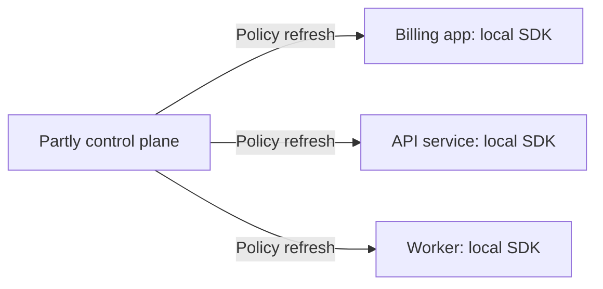
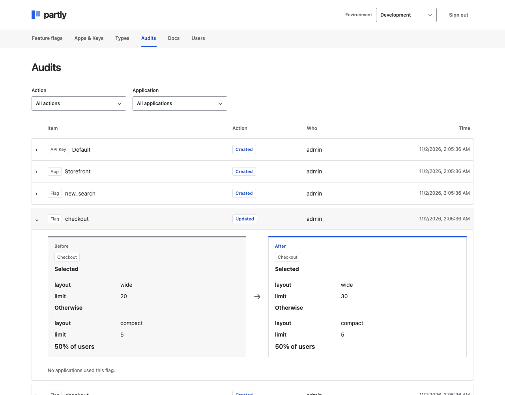

# Partly control plane

One executable serves the dashboard and API, with Axum and embedded SQLite. No separate assets or frontend runtime are needed.

## Source layout

| Location | Responsibility |
| --- | --- |
| `src/main.rs`, `cli.rs`, `server.rs` | Entry point, commands, listening, and shutdown |
| `src/api/handlers/` | HTTP handlers grouped by resource |
| `src/api/{models,openapi,error}.rs` | Request/response types, contract generation, HTTP errors |
| `src/store/` | Database operations grouped by resource; stored types in `models.rs` |
| `src/{auth,state,transport,logging}.rs` | Authentication limits, shared state, HTTP security, operational logs |
| `src/dashboard.rs` | Bundled dashboard routes and assets |

Unit tests live beside their module in `tests.rs`; process and browser tests are in [the E2E harness](../../tests/e2e/README.md). See the [Rust style rules](../../docs/releasing.md#rust-structure-and-formatting).

## Local build

From the repository root:

```sh
task build:server
./target/release/partly serve --host 127.0.0.1 --port 8080 --db ./partly.db
```

These flags show the defaults. The database's parent directory must exist. Reuse the same path on restart. Ctrl+C or SIGTERM stops the server, allowing up to three seconds for requests to finish. Account sessions expire after 12 hours or a restart.

## Request and policy limits

The server accepts up to 64 connections, including TLS handshakes, and 64 active requests. Excess connections close immediately; excess requests receive `503` with `Retry-After: 1`. Request bodies must finish within 10 seconds, even when bytes keep arriving, and stay within 16 KiB. Slow bodies receive `408`; oversized bodies receive `413`.

Saved policies reuse compiled rules across reads and applications. A cache update follows a successful database commit; rejected writes leave the previous policy intact. The shared evaluator enforces [rule and regex limits](../../docs/evaluation.md#custom-rules) in the server and every SDK. Existing databases that exceed these limits are rejected without modification; review their rules before upgrading.

## Logging

Operational logs go to standard error (`stderr`), with a timestamp, level, and named fields. The default `info` level records startup, shutdown, setup state, and successful setup, login, logout, and dashboard write requests. It also includes warnings and errors. Successful reads, assets, policy downloads (`200`/`304`), and usage reports (`204`) stay quiet at this level.

Warnings cover failed logins (`401`), denied requests (`403`), rejected hostnames (`421`), and the first throttled login for each peer IP in a rate-limit window. Further `429` responses in that window appear at `debug`. Internal request failures and process failures are errors.

For request summaries, including routine polling and ordinary `4xx` responses, enable `debug`:

```sh
./target/release/partly serve --db ./partly.db --log-level debug
```

The global `--log-level` option accepts `off`, `error`, `warn`, `info`, `debug`, or `trace`. It controls Partly logs only. Dependency logs remain disabled, and `RUST_LOG` is ignored.

Request entries include the HTTP method, matched route template, status, elapsed milliseconds, and actual peer IP, ignoring forwarded addresses. A route template such as `/api/environments/{env}/flags/{key}` keeps names out of logs. SQLite failures include safe error codes. Request and response bodies, headers, query strings, raw path values, credentials, and policy or context values are omitted.

Use your service manager to capture and retain `stderr`; Partly does not create or rotate log files. The listening message and password-reset confirmation go to standard output (`stdout`).

Operational logs describe server activity and request results. A successful write request can save the same values without changing data. Use **Audits** for the saved changes, who made them, and their before/after states. Audit entries are stored in SQLite in the same transaction as each change.

## HTTPS

Complete setup on `127.0.0.1` first. Stop the server, then restart with a certificate and key:

```sh
./target/release/partly serve --host 0.0.0.0 --port 8443 --db ./partly.db \
  --tls-cert ./certs/fullchain.pem --tls-key ./certs/privkey.pem \
  --hostname flags.example.com
```

Use `https://flags.example.com:8443` in the browser and SDK. Point that DNS name to the server and use a certificate covering it. `--hostname` accepts one DNS name without a scheme or port; direct IPs and `localhost` also remain accepted. `0.0.0.0` listens on all IPv4 interfaces.

- Supply both TLS flags. The certificate PEM must list the server certificate first, then intermediates. The matching private key must be unencrypted PEM.
- Invalid TLS configuration stops startup. HTTPS supports TLS 1.2/1.3 and HTTP/1.1/2, with no plaintext fallback or redirect. Omit both TLS flags for local HTTP.
- For a private certificate authority, trust its root in the browser and configure the [SDK CA bundle](../../sdk/python/README.md#https-and-private-certificate-authorities). Keep the private key on the server.
- Obtain and renew certificates externally, then restart Partly to load them.

## Setup and storage

Missing database: Partly shows setup on a loopback address without creating files. Submitting valid credentials creates the database, the initial administrator, and Development and Production environments in one transaction.

Existing database: Partly checks its schema, integrity, credentials, and policies before serving requests. Invalid or incompatible files are rejected, never reset. Schema v1 has no migrations; older incompatible POC databases need a fresh `--db` path.

Passwords use salted Argon2id hashes. API Keys are plaintext, so keep the database and backups private. New database files use owner-only permissions on Unix.

A persistent `<database>.lock` file prevents concurrent servers or password resets. Do not remove it while Partly is running; the OS releases the lock on exit. Unix databases with multiple hard links are rejected; remove extra links or use an independent copy. Symbolic links share the original database lock.

## Users and permissions

The initial administrator creates individual accounts in **Users**. Passwords are required; email invitations and SSO are not included. Assign a role independently for each environment, or grant instance administrator access.

| Access | Viewer | Editor | Manager | Instance administrator |
| --- | --- | --- | --- | --- |
| Read flags, types, app selections, masked key identifiers, and audits | ✅ | ✅ | ✅ | ✅ |
| Create, change, and delete flags | ❌ | ✅ | ✅ | ✅ |
| Manage types, apps, assignments, and keys; read key secrets | ❌ | ❌ | ✅ | ✅ |
| Manage users and permissions; access every environment | ❌ | ❌ | ❌ | ✅ |

Roles apply only to assigned environments. Accounts without assignments can sign in but cannot read environment data. Changes to permissions, passwords, or account status invalidate all of that account's sessions. Existing API Keys are application credentials: disabling their creator does not revoke those keys. Revoke them separately when needed.

Usernames cannot be renamed. Disable accounts instead of deleting them so audit identities remain clear. The initial administrator cannot be disabled or demoted; the offline recovery command resets that account's password only.

## Password recovery

Stop the server before changing or recovering the admin password. From a terminal with access to the database, run:

```sh
python3 -c 'import getpass; print(getpass.getpass("New admin password: "))' | \
  ./target/release/partly reset-password --db ./partly.db
```

Passwords must be 12–1024 UTF-8 bytes. The command reads one line from standard input and refuses direct terminal input; the prompt above hides your typing. Keep passwords out of command arguments and shell history.

The username, flags, and API Keys stay unchanged. The password reset is recorded in each environment's audit log as `offline recovery`, without the password or its hash. If that audit write fails, the password stays unchanged. Restart afterward and sign in again. Missing or invalid databases are rejected without replacement.

## Backup, restore, and upgrades

Stop Partly and wait for it to exit, then copy the database:

```sh
umask 077
cp -p ./partly.db ./partly-backup.db
chmod 600 ./partly-backup.db
```

Restart with the original path. Never copy a live database: transactions may depend on journal files. The `.lock` file is not part of the backup. Backups contain readable API Keys.

To restore, stop the server, copy the backup to a **new** path, and start Partly with that path:

```sh
cp -p ./partly-backup.db ./partly-restored.db
chmod 600 ./partly-restored.db
./target/release/partly serve --db ./partly-restored.db
```

For HTTPS, add your usual TLS flags. Sign in and verify flags and application access before removing the original file.

Before upgrading, back up the stopped database and keep the old executable. This alpha has no schema migrations. If a future upgrade changes the schema, rollback requires the matching older executable and its pre-upgrade backup.

## Dashboard

One server can manage several applications. Each app selects shared flags in its environment, and its API Keys download only that selection. Applications may run on other machines; evaluation stays inside their SDKs.



Use a current browser; dropdowns require the Popover API. Sign in at `/`. The environment selector reloads the page with the environment in the URL, such as `/environments/production/flags`.

- **Feature flags:** create and edit flags in the current environment. Choose a result type and an everyone, percentage, custom-rule, or nobody rollout. Unsaved changes trigger navigation warnings; saving one flag preserves other drafts. Existing edits and deletions always list affected apps (including an empty list) and require the exact `environment/flag_name`. Concurrent changes invalidate the confirmation.
- **Apps & Keys:** create an app, select its flags, and copy its permanent application ID. A Default API Key is generated automatically. Create extra keys for rotation; rename, copy, reveal, or revoke active keys. Revoked keys remain in history with a partial identifier and dates, but no copy/reveal. Apps are separate in each environment; newly created flags are not automatically assigned.
- **Types:** define named enums and flat JSON records for flag results. Names and definitions stay fixed. Managers can create types and delete unused ones; other environment members can inspect them.
- **Audits:** browse readable state changes, affected applications, and action/application filters. Updates show before → after; creation shows the initial state. Entries and their changes are saved in one transaction. Each change identifies the signed-in account. User and permission changes are recorded too.
- **Docs:** choose Python, Rust, Go, or Node.js, then Quickstart or Typed results. Copy the tested example and replace its URL, environment, application ID, and API Key constants. Each initializes once, reuses the client for local evaluation, handles errors, and closes at shutdown.
- **Users** (administrators only): create accounts, set environment roles, reset passwords, or disable access. Changes sign the affected user out. The initial administrator stays enabled for offline recovery.

API Keys read policies and report usage; they cannot edit flags or accounts. Masking hides keys visually; administrators and environment managers receive their values; other users receive only masked identifiers. When a policy or usage response confirms revocation, the SDK clears its policy and stops evaluation and background work. Disconnected SDKs cannot discover revocation until they communicate again. Ordinary network and server failures preserve the accepted policy.



## Usage reporting

The SDK remembers distinct known flag checks, including disabled decisions and checks with invalid context or the wrong result type. During evaluation it schedules a background report when 128 names are pending or 60 seconds have elapsed. It sends up to 128 names per request; repeated checks of the same flag use one entry. Evaluation never waits for that request. Failures retain pending names and wait at least 60 seconds before another evaluation can retry. Idle clients do not send; shutdown cancels reports and discards pending names.

The server stores one row per API Key and flag, using server receipt time. Each batch updates only the distinct flags still assigned to that key's app. Names removed since the SDK's last refresh are ignored. Policy contents, ETags, revisions, and audits are unaffected. Usage survives application edits and key revocation. Deleting a flag removes its usage; the key's displayed time is the maximum of its remaining flag rows.

**Feature flags** shows **Last reported use**, expandable by application and key. **Apps & Keys** shows each key's last reported use. Reload the page for updated activity. An empty history says **No usage reported**. These are cleanup hints: an idle, disconnected, closed, crashed, or older SDK may not report a flag it still uses. No evaluation contexts, outcomes, counts, or event history are sent.

Usage uses the initial v1 schema. Earlier development databases without its table are rejected without modification; use a fresh database path. No upgrade migration is included in this alpha.

## HTTP contract

[OpenAPI JSON](../../docs/openapi.json) is the API reference: routes, request/response schemas, status codes, authentication, headers, and limits. Development and release servers serve it at `GET /openapi.json` without sign-in, including before setup. The file, CLI export, and HTTP response use compact JSON. It contains no instance data or credentials.

The contract is generated with Utoipa from the registered Axum handlers and Rust types. Do not edit the JSON by hand. After changing the API, run from the repository root:

```sh
task api:export
```

The standalone executable can also export it without opening a database or starting a server:

```sh
./target/release/partly openapi --output openapi.json
```

Omit `--output` to print JSON to standard output. Import the document into your OpenAPI viewer or API client. The dashboard's **Docs** tab remains focused on SDK examples.

Dashboard writes use a session cookie and `X-Partly-Request: dashboard`. API Keys use bearer authentication with `X-Partly-Environment` and `X-Partly-Application`; they can only download policy and report usage. Confirmed revocation is a terminal `401` with `code: "key_revoked"` and `X-Partly-Error: key_revoked`. Ordinary failures preserve the SDK's accepted policy.

Contract tests compare the generated document with the checked-in file and validate real responses for every documented operation. They cover nullable/masked keys, typed results and rules, named types, policy caching, revocation, and empty `204`/`304` bodies. Run `cargo test --locked -p partly-server`, then build the server and run `cargo test --locked -p partly-e2e --test e2e api::openapi::`. These run in CI's **Build and test** tier.

Schemas describe wire structure. Validation that depends on stored state or runtime behavior—permissions, unique names, valid Rust regex, impact tokens, and policy size—still runs on the server. Axum extraction failures may be plain text; application errors are JSON. Both are documented.

## Typed flag results

Use **Types** to define immutable enums and flat JSON records, then choose a result type when creating a flag. Both selected and other values must match it. Types are environment-scoped; Managers create/delete them, and Editors may use existing types. Referenced types cannot be deleted, and deleted names remain reserved. Type and flag writes share the existing transactional audits.

[Typed results](../../docs/typed-results.md) describes bounds, OpenFeature getters, native enhancements, and v1/v2 policy compatibility. Upgrade SDKs before assigning typed flags. The type table is part of development schema v1; older incompatible development databases are preserved and rejected, not migrated or reset.
