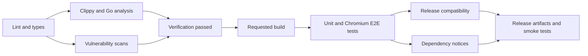

# Preparing a Partly release

Current candidate: `0.1.0-alpha.1` (Python: `0.1.0a1`). The root Cargo workspace is the release version source. Keep Node metadata, the internal Rust dependency pin, and Go example, contract, and provider requirements aligned; refresh `Cargo.lock` and build every component from the same commit. `tests/test_release_versions.py` enforces this in the default CI suite.

See [publishing each package and using alpha versions](publishing.md) for registry setup, commands, and the remaining npm/Go distribution work.

## Distribution targets

The packaging results below describe earlier candidates. Rebuild and rerun the release workflow on the final commit before publishing.

| Artifact | Target | Status |
| --- | --- | --- |
| Server | macOS ARM64 | Packaged HTTPS smoke passed locally |
| Server | Linux x86_64, static musl | No dynamic dependencies; packaged HTTPS smoke passed under emulation |
| Python SDK | macOS ARM64, CPython 3.14 | Built from source archive; installed-wheel HTTPS smoke passed |
| Python SDK | Linux x86_64, manylinux2014, CPython 3.14 | Native CI must build and verify the new version-specific wheel |
| Rust, Go, Node.js SDKs | macOS ARM64 | Standalone packages passed the shared contract checks |
| Rust, Go, Node.js SDKs | Linux x86_64 | Built and tested outside the checkout under emulation |

Python support and CI target regular CPython 3.14 only, using version-specific `cp314` wheels. Other Python versions, Windows, Linux ARM64, Intel macOS, Alpine Python, and free-threaded Python are outside this release. The Linux wheel requires glibc; the server is static. Earlier ABI3 candidate wheels are superseded and must not be published.

The prebuilt Linux Node.js addon requires glibc 2.34+. Go consumers need cgo and a C compiler. Neither prebuilt package requires a Rust toolchain.

The Rust E2E suite covers the API, SDKs, recovery, and dashboard. All 27 dashboard tests passed locally in Chromium, Firefox, and WebKit, including audits, modal confirmations, and served examples. Safari releases and physical mobile devices remain untested.

Earlier candidates passed Rust, Python, Go race, Node.js, packaging, and HTTPS smoke tests on macOS. Minimum-version checks covered Rust 1.89, Go 1.22.12, and Node.js 22.0.0. Linux checks ran under QEMU with compiler workarounds; Chromium and Go vet could not complete there. Native Linux CI must verify the current source and artifacts.

OpenFeature source checks passed in all four languages for lifecycle, context precedence, hooks, typed errors and isolation. The macOS ARM64 package check also passed 37 native/OpenFeature contract and quickstart tests using an installed CPython 3.14 wheel built from its source archive, extracted Rust/Go packages, and an npm-installed tarball. These cover refresh, outages, revocation, and the runnable dashboard examples. Packages remain unpublished; native Linux CI must repeat the checks. See the [compatibility record](openfeature.md#coverage-and-limits); Rust's upstream limits remain explicit.

This candidate also adds individual accounts and environment permissions. The development schema remains v1, with no migration from older POC layouts. Use a fresh database path for an incompatible older database; the server rejects it without modifying it. See [storage and recovery](../crates/partly-server/README.md#setup-and-storage).

## Build and verify

Follow the [server setup](../README.md#build-locally) and [Python SDK build](../sdk/python/README.md#build-locally), then run from the repository root with that virtual environment active. The full suite also needs Go and Node.js (locally tested with Go 1.27.3 and Node.js 26.10.0):

```sh
python -m pip install -r config/requirements-dev.txt
cargo run --locked -p partly-e2e --features browser --bin partly-test-browsers -- chromium
cargo fmt --all --check
python -m ruff check .
python -m mypy
npm ci --ignore-scripts --no-audit --no-fund
npm run lint
npm run typecheck
shellcheck sdk/go/build.sh
go install github.com/rhysd/actionlint/cmd/actionlint@v1.7.12
actionlint
go install honnef.co/go/tools/cmd/staticcheck@v0.8.2
for module in sdk/go sdk/go/openfeature examples/go tests/sdk_contract/go tests/sdk_contract/go_openfeature; do
  (cd "$module" && go vet ./... && staticcheck ./...)
done
PLAYWRIGHT_SKIP_DRIVER_DOWNLOAD=1 PYO3_PYTHON="$VIRTUAL_ENV/bin/python" cargo clippy --locked --workspace --all-targets --all-features -- -D warnings
PYO3_PYTHON="$VIRTUAL_ENV/bin/python" cargo test --locked --workspace --all-features --exclude partly-e2e
python -m mypy.stubtest partly._native
cargo build --locked -p partly-server -p partly-sdk-contract
sh sdk/go/build.sh
node sdk/node/build.js
(cd sdk/go && go vet ./... && go test -a -race ./...)
(cd sdk/go/openfeature && go test -a -race ./...)
node --test sdk/node/test/*.test.js
python -m pytest -q
cargo test --locked -p partly-e2e --features browser --test e2e -- --test-threads=4
```

Tests use temporary servers and databases. `PARTLY_BINARY` selects an absolute executable path. `PARTLY_BROWSER=firefox` or `webkit` selects an installed browser for focused checks. Test reports and screenshots stay outside Git.

Python checks discover settings in the root `pyproject.toml`. Frontend settings live in `config/`; use the npm commands above so each tool loads the right file. CI uses those same commands and installs `config/requirements-dev.txt`.

The [Rust E2E harness](../tests/e2e/README.md) runs the [four-language contract](../tests/sdk_contract/README.md), [OpenFeature tests](../tests/sdk_contract/README.md#openfeature-contract), RBAC tests, and minimal examples. All must pass before committing. Go links a bundled Rust static library; use `-a` after replacing it because Go's cache does not track archive changes.

Build standalone SDK packages and run the same contracts outside the checkout (Python 3.14):

```sh
python scripts/package_sdks.py --output target/sdk-packages
PARTLY_SDK_PACKAGES="$PWD/target/sdk-packages" cargo test --locked -p partly-e2e --test e2e sdk::contract:: -- --test-threads=4
PARTLY_SDK_PACKAGES="$PWD/target/sdk-packages" cargo test --locked -p partly-e2e --test e2e sdk::examples:: -- --test-threads=4
```

The output contains two Rust `.crate` files, a Go archive with its static library and optional provider module, and a Node npm tarball with its native extension and provider. Rust packaging verifies all features in a fresh temporary registry to avoid reusing an older unpublished alpha at the same version. Go and Node archives target the build machine; build both macOS ARM64 and Linux x86_64. Consumers do not need Rust for those prebuilt archives. During development only, `--allow-dirty` tests uncommitted packaging changes. Publishing to registries remains a separate step.

Optional: `python tests/benchmark.py` measures a release build's size, startup, sampled memory, and Python evaluation including binding overhead. It is not a load test.

## CI gates

Each tier can run on its own from **Actions → select workflow → Run workflow**. Higher tiers call the same lower-tier workflow and wait for it to pass:

| Workflow | Runs automatically | Includes |
| --- | --- | --- |
| [Lint and types](../.github/workflows/lint.yml) | Called by Verify | Formatting, source lint, Python/TypeScript types, version consistency |
| [Verify](../.github/workflows/verify.yml) | PRs and main pushes | Lint/types, Rust and Go compiler analysis, vulnerability scans |
| [Build and test](../.github/workflows/build.yml) | Called by Release artifacts | Verify, component builds, unit tests, native/OpenFeature SDK contracts, RBAC and Chromium E2E |
| [Release artifacts](../.github/workflows/release-checks.yml) | `v*` tags | Build-and-test, compatibility, licenses, Linux/macOS packages and smoke tests |



PRs and main pushes stop at **PR checks** in Verify. Make that status required in branch protection once hosted. They do not build Partly binaries or SDK packages, install browsers, or run tests that need those builds. Request **Build and test** when runtime validation is needed; request **Release artifacts** for the full release gates. Manual workflows become available after their files reach the default branch, and can target another branch.

Clippy performs Rust compiler checks as well as linting, so verification does not repeat `cargo check`. Go vet/Staticcheck check package types; mypy and `tsc --noEmit` check the Python and TypeScript APIs without native builds. These checks catch compile/type errors but cannot prove linking, packaging, or runtime behavior. Reuse means calling the same checks within the requested run, not trusting an older green run; caches reduce repeated compiler work.

| Code | Required checks |
| --- | --- |
| Rust | rustfmt and Clippy, warnings fail |
| Python | Ruff and strict mypy for the SDK, native stub, examples, and release scripts |
| Go | gofmt, vet, and Staticcheck for SDK, example, and contract driver |
| JavaScript/TypeScript | ESLint, strict TypeScript declarations and consumer checks |
| HTML/CSS | HTML-validate and Biome's recommended CSS checks |
| Shell/workflows | ShellCheck and actionlint |

The [vulnerability workflow](../.github/workflows/vulnerabilities.yml) uses RustSec, pip-audit, govulncheck, and npm audit. It runs on every PR/release workflow and daily, and fails on findings or scanner errors. Python and npm scans include development dependencies; Go scans include the standard library. Native Node usage has no JavaScript runtime dependencies; its optional OpenFeature adapter requires the official server SDK. Package audits do not audit Node/Python interpreters themselves; keep their supported patch versions current. Release Go builds use 1.27.3; Go 1.22 is checked only for native-client compatibility. The separate OpenFeature Go module requires Go 1.26+.

Release jobs build the Python wheel from its source archive and test installed packages outside the checkout, including HTTPS, shutdown, OpenFeature contracts, and all four quickstarts. They produce archives and checksums, without publishing. Require a green run on the exact release commit.

Remaining automation gaps: checksums are generated but uploaded artifacts are not downloaded and verified; the Linux Node.js addon's documented glibc minimum is not enforced. macOS runs packaged SDK contracts and smoke tests; the full application/browser suite runs on Linux.

`scripts/prepare_sdist.py` removes unrelated workspace entries from the archived lockfile, preserving dependency versions and checksums. The repository lockfile stays unchanged; wheels build with `--locked`. Run release helpers with Python 3.14.

To check an artifact locally, extract the final server archive and inspect its notices. In a fresh virtual environment outside the checkout, install the exact wheel, `trustme`, and `packaging`. Copy `scripts/release_smoke.py` there and run:

```sh
python -I release_smoke.py /absolute/path/to/partly
```

Run `python -m twine check --strict` on the wheel and source archive. Verify downloads against `SHA256SUMS`; these checksums are not publisher signatures.

## Before public upload

1. Verify packaged licenses, dependency terms, and contributor rights against [licensing boundaries](licensing.md).
2. Use [ByteBaker/partly](https://github.com/ByteBaker/partly) as the source repository and confirm ownership of `partly-sdk` on PyPI.
3. Deploy `https://partly.sh/install` and `https://partly.sh/docs`, or replace these placeholder metadata links.
4. Pass **Release artifacts** on the final commit, resolve advisories, and test the downloaded artifacts.
5. Configure PyPI Trusted Publishing or a scoped credential outside source control.
6. Publish approved archives, wheels, source, checksums, and release notes. Link the [backup and upgrade procedure](../crates/partly-server/README.md#backup-restore-and-upgrades).

Signing, notarization, and an automatic installer are not included in this alpha.

## Refresh dependency notices

Notices are tracked. After dependency or target changes, regenerate them from the repository root:

```sh
cargo install cargo-about --version 0.9.2 --locked
cargo fetch --locked
cargo about generate --locked --offline --fail --config licenses/about.toml --manifest-path crates/partly-server/Cargo.toml --target x86_64-unknown-linux-musl --target aarch64-apple-darwin licenses/third-party.hbs --output-file licenses/THIRD_PARTY_NOTICES.txt
cargo about generate --locked --offline --fail --config licenses/about.toml --manifest-path sdk/python/Cargo.toml --target x86_64-unknown-linux-gnu --target aarch64-apple-darwin licenses/third-party.hbs --output-file sdk/python/THIRD_PARTY_NOTICES.txt
for language in rust node; do
  cargo about generate --all-features --locked --offline --fail --config licenses/about.toml --manifest-path "sdk/$language/Cargo.toml" --target x86_64-unknown-linux-gnu --target aarch64-apple-darwin licenses/third-party.hbs --output-file "sdk/$language/THIRD_PARTY_NOTICES.txt"
done
cargo about generate --locked --offline --fail --config licenses/about.toml --manifest-path crates/partly-ffi/Cargo.toml --target x86_64-unknown-linux-gnu --target aarch64-apple-darwin licenses/third-party.hbs --output-file sdk/go/THIRD_PARTY_NOTICES.txt
```

Review changes and diagnostics: cargo-about 0.9.2 can exit successfully after a clarification checksum mismatch. CI rejects that diagnostic and stale notices. Recheck upstream license checksums in `licenses/about.toml` when upgrading affected dependencies. Generated notices do not replace a review of dependency terms.

Release builds pin Rust 1.98.1. When changing compilers, update the workflow pin and the `RUST_STDLIB_NOTICES.html` files under `sdk/python`, `sdk/go`, and `sdk/node` from that compiler's `share/doc/rust/COPYRIGHT-library.html`. CI verifies an exact match. Local builds also need matching compiler notices before redistribution.

The Linux server archive includes its build runner's musl copyright file; the archive smoke check compares it with that source file. Separately installed Python dependencies carry their own notices.

Dependency scans passed after the previous TLS and Go updates. Run them again for the release commit; earlier scan results do not validate newly built artifacts.
