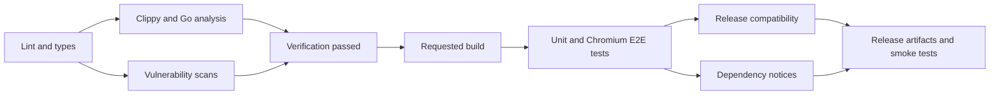

# Preparing a Partly release

Current candidate: `0.1.0-alpha.1` (Python: `0.1.0a1`). The root Cargo workspace is the release version source. Keep Node metadata, the internal Rust dependency pin, and Go example, contract, and provider requirements aligned; refresh `Cargo.lock` and build every component from the same commit. `tests/test_release_versions.py` enforces this in the default CI suite.

See [publishing each package and using alpha versions](publishing.md) for registry setup, commands, and the remaining npm/Go distribution work.

## Distribution targets

The packaging results below describe earlier candidates. Rebuild and rerun the release workflow on the final commit before publishing.

| Artifact | Target | Status |
| --- | --- | --- |
| Server | macOS ARM64 | Packaged HTTPS smoke passed locally |
| Server | Linux x86_64, static musl | No dynamic dependencies; packaged HTTPS smoke passed under emulation |
| Python SDK | macOS ARM64, CPython 3.14 | Built from source archive; installed-wheel HTTPS smoke passed |
| Python SDK | Linux x86_64, manylinux2014, CPython 3.14 | Native CI must build and verify the new version-specific wheel |
| Rust, Go, Node.js SDKs | macOS ARM64 | Standalone packages passed the shared contract checks |
| Rust, Go, Node.js SDKs | Linux x86_64 | Built and tested outside the checkout under emulation |

Python support and CI target regular CPython 3.14 only, using version-specific `cp314` wheels. Other Python versions, Windows, Linux ARM64, Intel macOS, Alpine Python, and free-threaded Python are outside this release. The Linux wheel requires glibc; the server is static. Earlier ABI3 candidate wheels are superseded and must not be published.

The prebuilt Linux Node.js addon requires glibc 2.34+. Go consumers need cgo and a C compiler. Neither prebuilt package requires a Rust toolchain.

The Rust E2E suite covers the API, SDKs, recovery, and dashboard. All 34 dashboard tests passed locally in Chromium, Firefox, and WebKit, including typed results, long names, usage reporting, audits, modal confirmations, and served examples. Safari releases and physical mobile devices remain untested.

Earlier candidates passed Rust, Python, Go race, Node.js, packaging, and HTTPS smoke tests on macOS. Minimum-version checks covered Rust 1.89, Go 1.22.12, and Node.js 22.0.0. Linux checks ran under QEMU with compiler workarounds; Chromium and Go vet could not complete there. Native Linux CI must verify the current source and artifacts.

OpenFeature source checks passed in all four languages for lifecycle, context precedence, hooks, typed results/errors, and isolation. The macOS ARM64 package check also passed 38 SDK contract, usage, and example tests using an installed CPython 3.14 wheel built from its source archive, extracted Rust/Go packages, and an npm-installed tarball. These cover typed getters and named-type metadata, rejected v2 refreshes, usage after wrong-type checks, outages, revocation, and both dashboard examples. Wheel and source metadata passed strict checks. Native Linux release CI must repeat these checks. Packages remain unpublished. See the [compatibility record](openfeature.md#coverage-and-limits); Rust's upstream limits remain explicit.

This candidate includes individual accounts, environment permissions, and named result types. The development schema remains v1, with no migration from older POC layouts. Use a fresh database path for an incompatible older database; the server rejects it without modifying it. Upgrade SDKs before assigning typed flags to applications. See [storage and recovery](../crates/partly-server/README.md#setup-and-storage) and [policy compatibility](typed-results.md#policy-compatibility).

## Build and verify

Use Task as the single command entry point for development and CI. Its named tasks call Cargo and the existing language tools, with explicit ordering and shared commands defined in [Taskfile.yml](../Taskfile.yml).

Install [Task](https://taskfile.dev/docs/installation), Rust, Go, Node.js, a C compiler, and regular CPython 3.14. CI pins Task 3.53.1. For just the server, Task, Rust, and a C compiler are enough: run `task build:server`.

Prepare the development checkout once:

```sh
task setup
```

This creates `.venv`, installs Python/frontend dependencies, audit tools, Rust's LLVM archive tools, and the prek pre-push hook. Rust and Go scanners live in `.cache/audit-tools`; Go downloads the pinned audit toolchain when needed. Other system toolchains must already be installed. An existing environment with the wrong Python version is rejected without replacing it. Shell activation is not needed.

| Command | What it does |
| --- | --- |
| `task` | List available commands |
| `task check` | Pre-push lint and vulnerability checks; no product builds |
| `task lint` | Source checks only; CI runs security as a separate required tier |
| `task api:export` | Generate `docs/openapi.json` from the server; compiles the server if needed |
| `task audit` | All four vulnerability scans; use `audit:rust`, `audit:python`, `audit:go`, or `audit:node` for one |
| `task build` | Check sources, then build the server and all four SDKs |
| `task test` | Build, install the local wheel, prepare Chromium, and run all tests |
| `task build:server` | Build only the release server at `target/release/partly` |
| `task build:python` | Build only the CPython 3.14 wheel in `target/wheels/` |
| `task build:rust` | Build only the Rust SDK with OpenFeature |
| `task build:go` | Build only the Go native library |
| `task build:node` | Build only the Node addon |
| `task install:python` | Build and install the Python SDK locally |
| `task test:run` | Run the suite against prepared artifacts, as CI does |

A failed check stops `task build` and `task test` before compilation. Failed builds stop the later steps. CI calls `build:artifacts` after Verify passes, avoiding duplicate scans. Component targets allow focused builds. All commands live in `Taskfile.yml`; the language-specific native build helpers remain shared with release packaging. No task publishes packages.

On Linux, install browser system dependencies once with `task browsers -- --with-deps chromium`. `task test` then reuses the downloaded browser. `task test:run` expects built native libraries, an installed Python wheel, development dependencies, and Chromium; missing requirements fail the run.

For an existing environment, pass `VENV=/absolute/path` to a task. CI passes `PYTHON=/absolute/path/to/python` to use its installed interpreter. For Git hooks with a nondefault environment, export `PARTLY_PYTHON` and put that environment's `bin` directory on `PATH`. Normal `.venv` setups need no activation. The existing `PARTLY_BINARY` and `PARTLY_BROWSER` test settings still work.

### Rust structure and formatting

Group modules by responsibility, then separate models, logic, and tests. The server has `api/handlers/` for HTTP resources and `store/` for database operations; each has its own `models.rs`. The evaluator separates policy validation, rules, numeric handling, and evaluation. Keep entry points and module registries small, with public SDK exports preserved at the crate root.

Put unit tests in a sibling `tests.rs` or `tests/` directory, and group E2E tests by workflow. Review files approaching 400 lines for unrelated responsibilities; do not split a coherent workflow just to meet a line count. Keep small helpers with the code that uses them.

Run `cargo fmt --all` before checking changes. The root `.rustfmt.toml` uses stable settings: 100-column layout, Unix line endings, ordered imports/modules, field shorthand, and the 2024 formatting style. The Rust language edition stays 2021. Editors, prek, and CI use the same file; no nightly toolchain is needed. Rustfmt cannot choose module boundaries or reliably wrap long SQL and macro bodies, so review those manually.

### Pre-push checks

[prek](https://prek.j178.dev/0.5.5/reference/configuration/) runs `config/prek.toml` before a push. Source checks cover conflict markers, JSON/TOML/YAML syntax, Rust/Go formatting, Python/frontend/shell lint, and version consistency. They select changed files. RustSec, pip-audit, govulncheck, and npm audit run on **every push**, even when only documentation changes: new advisories can affect unchanged dependencies. The four scans run concurrently after source checks and share their Task commands with CI.

Findings, missing scanners, failed resolution, and network errors block the push. Scans need network access and do not fix files automatically. Run `task setup` after pulling changes to tool requirements. `task check` also checks every tracked source file. No product builds or browser tests run during a push. Strict types, Clippy, and Go analysis remain in **Verify**, alongside the required security jobs. Daily scans remain enabled.

Python audits resolve declared runtime, OpenFeature, and development requirements in isolation, without building or querying the unpublished Partly wheel. npm audits the committed lockfile, including development dependencies. Go audits all five modules with the pinned patched toolchain. These checks cover the project dependencies, not every package installed in a developer's environment.

The temporary `minimatch` override selects 11.0.1 for [GHSA-g3hv-75wg-m249](https://github.com/advisories/GHSA-g3hv-75wg-m249). Remove it when ESLint and TypeScript-ESLint resolve patched versions themselves; verify frontend lint and types after either change.

Tests use temporary servers and databases. `PARTLY_BINARY` selects an absolute executable path. `PARTLY_BROWSER=firefox` or `webkit` selects an installed browser for focused checks. Test reports and screenshots stay outside Git.

Python checks discover settings in the root `pyproject.toml`. Frontend settings live in `config/`; use `npm run lint` and `npm run typecheck` so each tool loads the right file. CI uses those same commands and installs `config/requirements-dev.txt`.

The [Rust E2E harness](../tests/e2e/README.md) runs the [four-language contract](../tests/sdk_contract/README.md), [OpenFeature tests](../tests/sdk_contract/README.md#openfeature-contract), RBAC tests, and minimal examples. All must pass before committing. Go links a bundled Rust static library; use `-a` after replacing it because Go's cache does not track archive changes.

Build standalone SDK packages and run the same contracts outside the checkout (Python 3.14):

```sh
python scripts/package_sdks.py --output target/sdk-packages
PARTLY_SDK_PACKAGES="$PWD/target/sdk-packages" cargo test --locked -p partly-e2e --test e2e sdk::contract:: -- --test-threads=4
PARTLY_SDK_PACKAGES="$PWD/target/sdk-packages" cargo test --locked -p partly-e2e --test e2e sdk::examples:: -- --test-threads=4
PARTLY_SDK_PACKAGES="$PWD/target/sdk-packages" cargo test --locked -p partly-e2e --test e2e sdk::usage:: -- --test-threads=4
```

The output contains one `partly-rust` `.crate` file with the evaluator included, a Go archive with its static library and optional provider module, and a Node npm tarball with its native extension and provider. Rust packaging verifies the extracted crate with all features enabled, then runs its evaluator tests with default features disabled. Both checks use a fresh temporary build directory.

Go and Node archives target the build machine; build both macOS ARM64 and Linux x86_64. Consumers do not need Rust for those prebuilt archives. During development only, `--allow-dirty` tests uncommitted packaging changes. Publishing to registries remains a separate step.

### Benchmarks

After `task build:server` and `task install:python`, run `.venv/bin/python tests/benchmark.py`. The script measures binary size, startup, sampled server memory, and native Python evaluation, including Rust binding overhead.

The October 24, 2026 run recorded approximately **26.2 MiB server memory** and **0.57 µs per Python evaluation**. It used one 50% flag and a fixed user ID, taking the median of five batches of 100,000 calls. Evaluation includes binding and usage tracking costs, but excludes OpenFeature and report dispatch. Memory excludes the application SDK and browser.

This is a historical baseline with no application load, not a production sizing recommendation, tail-latency measurement, or cross-product speed comparison. Rerun it for performance changes; do not treat it as a result for every later commit.

## CI gates

Each tier can run on its own from **Actions → select workflow → Run workflow**. Higher tiers call the same lower-tier workflow and wait for it to pass:

| Workflow | Runs automatically | Includes |
| --- | --- | --- |
| [Lint and types](../.github/workflows/lint.yml) | Called by Verify | Formatting, source lint, Python/TypeScript types, version consistency |
| [Verify](../.github/workflows/verify.yml) | PRs and main pushes | Lint/types, Rust and Go compiler analysis, vulnerability scans |
| [Build and test](../.github/workflows/build.yml) | Called by Release artifacts | Verify, component builds, unit tests, native/OpenFeature SDK contracts, RBAC and Chromium E2E |
| [Release artifacts](../.github/workflows/release-checks.yml) | `v*` tags | Build-and-test, compatibility, licenses, Linux/macOS packages and smoke tests |



PRs and main pushes stop at **PR checks** in Verify. Make that status required in branch protection once hosted. They do not build Partly binaries or SDK packages, install browsers, or run tests that need those builds. Request **Build and test** when runtime validation is needed; request **Release artifacts** for the full release gates. Manual workflows become available after their files reach the default branch, and can target another branch.

Clippy performs Rust compiler checks as well as linting, so verification does not repeat `cargo check`. Go vet/Staticcheck check package types; mypy and `tsc --noEmit` check the Python and TypeScript APIs without native builds. These checks catch compile/type errors but cannot prove linking, packaging, or runtime behavior. Reuse means calling the same checks within the requested run, not trusting an older green run; caches reduce repeated compiler work.

| Code | Required checks |
| --- | --- |
| Rust | rustfmt and Clippy, warnings fail |
| Python | Ruff and strict mypy for the SDK, native stub, examples, and release scripts |
| Go | gofmt, vet, and Staticcheck for SDK, example, and contract driver |
| JavaScript/TypeScript | ESLint, strict TypeScript declarations and consumer checks |
| HTML/CSS | HTML-validate and Biome's recommended CSS checks |
| Shell/workflows | ShellCheck and actionlint |

The [vulnerability workflow](../.github/workflows/vulnerabilities.yml) uses RustSec, pip-audit, govulncheck, and npm audit. It runs on every PR/release workflow and daily, and fails on findings or scanner errors. Python and npm scans include development dependencies; Go scans include the standard library. Native Node usage has no JavaScript runtime dependencies; its optional OpenFeature adapter requires the official server SDK. Package audits do not audit Node/Python interpreters themselves; keep their supported patch versions current. Release Go builds use 1.27.4; Go 1.22 is checked only for native-client compatibility. The separate OpenFeature Go module requires Go 1.26+.

Release jobs build the Python wheel from its source archive and test installed packages outside the checkout, including HTTPS, shutdown, OpenFeature contracts, and all four quickstarts. They produce archives and checksums, without publishing. Require a green run on the exact release commit.

Remaining automation gaps: checksums are generated but uploaded artifacts are not downloaded and verified; the Linux Node.js addon's documented glibc minimum is not enforced. macOS runs packaged SDK contracts and smoke tests; the full application/browser suite runs on Linux.

`scripts/prepare_sdist.py` removes unrelated workspace entries from the archived lockfile, preserving dependency versions and checksums. The repository lockfile stays unchanged; wheels build with `--locked`. Run release helpers with Python 3.14.

To check an artifact locally, extract the final server archive and inspect its notices. In a fresh virtual environment outside the checkout, install the exact wheel, `trustme`, and `packaging`. Copy `scripts/release_smoke.py` there and run:

```sh
python -I release_smoke.py /absolute/path/to/partly
```

Run `python -m twine check --strict` on the wheel and source archive. Verify downloads against `SHA256SUMS`; these checksums are not publisher signatures.

## Before public upload

1. Verify packaged licenses, dependency terms, and contributor rights against [licensing boundaries](licensing.md).
2. Use [ByteBaker/partly](https://github.com/ByteBaker/partly) as the source repository and confirm ownership of `partly-sdk` on PyPI.
3. Use [GitHub Releases](https://github.com/ByteBaker/partly/releases) for public downloads. Attach verified artifacts to the matching versioned release; the domain is not a release prerequisite.
4. Pass **Release artifacts** on the final commit, resolve advisories, and test the downloaded artifacts.
5. Configure PyPI Trusted Publishing or a scoped credential outside source control.
6. Publish approved archives, wheels, source, checksums, and release notes. Link the [backup and upgrade procedure](../crates/partly-server/README.md#backup-restore-and-upgrades).

Signing, notarization, and an automatic installer are not included in this alpha.

## Refresh dependency notices

Notices are tracked. After dependency or target changes, regenerate them from the repository root:

```sh
cargo install cargo-about --version 0.9.2 --locked
cargo fetch --locked
cargo about generate --locked --offline --fail --config licenses/about.toml --manifest-path crates/partly-server/Cargo.toml --target x86_64-unknown-linux-musl --target aarch64-apple-darwin licenses/third-party.hbs --output-file licenses/THIRD_PARTY_NOTICES.txt
cargo about generate --locked --offline --fail --config licenses/about.toml --manifest-path sdk/python/Cargo.toml --target x86_64-unknown-linux-gnu --target aarch64-apple-darwin licenses/third-party.hbs --output-file sdk/python/THIRD_PARTY_NOTICES.txt
for language in rust node; do
  cargo about generate --all-features --locked --offline --fail --config licenses/about.toml --manifest-path "sdk/$language/Cargo.toml" --target x86_64-unknown-linux-gnu --target aarch64-apple-darwin licenses/third-party.hbs --output-file "sdk/$language/THIRD_PARTY_NOTICES.txt"
done
cargo about generate --locked --offline --fail --config licenses/about.toml --manifest-path crates/partly-ffi/Cargo.toml --target x86_64-unknown-linux-gnu --target aarch64-apple-darwin licenses/third-party.hbs --output-file sdk/go/THIRD_PARTY_NOTICES.txt
```

Review changes and diagnostics: cargo-about 0.9.2 can exit successfully after a clarification checksum mismatch. CI rejects that diagnostic and stale notices. Recheck upstream license checksums in `licenses/about.toml` when upgrading affected dependencies. Generated notices do not replace a review of dependency terms.

Release builds pin Rust 1.98.1. When changing compilers, update the workflow pin and the `RUST_STDLIB_NOTICES.html` files under `sdk/python`, `sdk/go`, and `sdk/node` from that compiler's `share/doc/rust/COPYRIGHT-library.html`. CI verifies an exact match. Local builds also need matching compiler notices before redistribution.

The Linux server archive includes its build runner's musl copyright file; the archive smoke check compares it with that source file. Separately installed Python dependencies carry their own notices.

Dependency scans passed after the previous TLS and Go updates. Run them again for the release commit; earlier scan results do not validate newly built artifacts.
